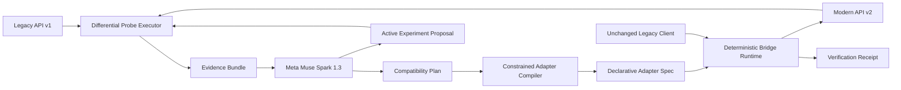

# ProtocolSmith

[](https://github.com/mkhan48-debug/protocolsmith-meta-hackathon/actions/workflows/ci.yml)

**ProtocolSmith is an active API-archaeology agent that discovers undocumented behavioral differences between API versions, compiles a constrained compatibility bridge, and proves that unchanged legacy software works again.**

Built by **Muhammad Rafae Khan** for the **Meta Global AI Developer Hackathon 2026**.

- Track: Indie Developer
- Theme: Push the Frontier
- Meta technology: Muse Spark 1.3 through the Meta Model API
- Status: Working hackathon prototype

## The problem

API migrations rarely fail only because a field was renamed. Real incompatibilities include:

- Request-parameter changes
- Nested response restructuring
- Value and type conversions
- Pagination changes
- Error bodies that change meaning
- HTTP status codes that no longer mean the same thing
- Information that disappears entirely

Documentation often misses these behavioral details. Existing clients then break even when the new API appears similar.

## What ProtocolSmith does

ProtocolSmith:

1. Runs controlled experiments against legacy and modern APIs.
2. Records status codes, values, response shapes, errors, and pagination behavior.
3. Uses Meta Muse Spark to infer evidence-backed compatibility hypotheses.
4. Lets Muse design a discriminating follow-up experiment.
5. Compiles the findings into a constrained declarative adapter specification.
6. Executes that specification through a deterministic compatibility bridge.
7. Replays legacy contracts and produces a machine-readable verification receipt.
8. Clearly reports lossy or unsupported transformations instead of hiding uncertainty.

## Decisive demonstration

The same unchanged legacy client produces three different outcomes:

```text
Legacy client → API v1
PASS

Legacy client → API v2 directly
FAIL: the expected "orders" field no longer exists

Legacy client → ProtocolSmith bridge → API v2
PASS
```

ProtocolSmith translates:

```text
page_size                → limit
customer_id              ← customer.id
orders                   ← data
id                       ← order_id
total_cents              ← amount.value
created_at               ← created
status                   ← state
next_page                ← pagination.next_cursor
HTTP 404 legacy error    ← HTTP 200 modern error object
```

## Why Meta Muse Spark is essential

Muse Spark is part of the product runtime—not merely a coding assistant.

Muse performs three constrained reasoning tasks:

1. **Compatibility discovery:** It analyzes paired black-box observations and produces a typed compatibility plan.
2. **Safe adapter compilation:** It converts evidence-backed findings into a declarative specification containing only allowlisted operations.
3. **Active experiment design and assessment:** It proposes a bounded
   follow-up probe and assesses the resulting evidence.

The deterministic executor runs that proposal as a six-case control
matrix: each API is tested with no parameter, the other version's
parameter, and its proposed parameter. A mapping is accepted only when
both baselines and swapped-name negative controls behave as predicted,
both correct names produce the predicted effect, and Muse's evidence
assessment agrees.

ProtocolSmith never executes arbitrary model-generated source code.

## Architecture



## Safety design

ProtocolSmith separates model reasoning from execution:

- Model output is constrained with typed Pydantic schemas.
- Adapter operations come from a small allowlist.
- Arbitrary generated Python code is never executed.
- Remote target URLs are blocked unless explicitly enabled.
- Redirects are disabled.
- Requests use timeouts.
- Response size is limited.
- Unsupported currencies fail closed.
- Missing response paths are rejected.
- Lossy transformations generate an explicit warning.
- API keys remain in an ignored local `.env` file.

## Quick start

### Requirements

- Python 3.12
- `uv`
- A Meta Model API key for regenerating Muse artifacts

### Clone and install

```bash
git clone https://github.com/mkhan48-debug/protocolsmith-meta-hackathon.git
cd protocolsmith-meta-hackathon
uv sync --locked --all-groups
```

### Configure the Meta API key

Create a local `.env` file:

```text
MODEL_API_KEY=your_meta_model_api_key_here
```

Never commit `.env`. The repository includes only `.env.example`.

### One-command demo (recommended)

Start the controlled laboratory, generated bridge, and dashboard together:

```bash
uv run protocolsmith
```

The dashboard opens automatically at `http://127.0.0.1:8001`. Press
`Control+C` once in the launcher Terminal to stop every service cleanly.

### Manual start (optional)

#### Start the controlled API laboratory

```bash
uv run uvicorn protocolsmith_meta_hackathon.lab_api:app \
  --host 127.0.0.1 \
  --port 8000
```

#### Start the dashboard and compatibility bridge

In another Terminal:

```bash
uv run uvicorn protocolsmith_meta_hackathon.dashboard_api:app \
  --host 127.0.0.1 \
  --port 8001
```

Open:

```text
http://127.0.0.1:8001
```

Click **Run live compatibility proof**.

## Reproduce the command-line demonstration

Legacy API succeeds:

```bash
uv run python scripts/legacy_client.py \
  --base-url http://127.0.0.1:8000/v1
```

Modern API fails the unchanged contract:

```bash
uv run python scripts/legacy_client.py \
  --base-url http://127.0.0.1:8000/v2
```

Generated bridge restores compatibility:

```bash
uv run python scripts/legacy_client.py \
  --base-url http://127.0.0.1:8001
```

## Regenerate the AI artifacts

Run differential discovery:

```bash
uv run python scripts/run_discovery.py
```

Compile the safe adapter specification:

```bash
uv run python scripts/compile_adapter.py
```

Run a Muse-designed active experiment:

```bash
uv run python scripts/run_active_probe.py
```

Run deterministic end-to-end verification:

```bash
uv run python scripts/verify_bridge.py
```

## Tests

```bash
uv run pytest -q
```

The repository also runs the test suite automatically through GitHub Actions.

## Evidence artifacts

ProtocolSmith produces:

- `artifacts/discovery_report.json`
- `artifacts/adapter_spec.json`
- `artifacts/active_probe_trace.json`
- `artifacts/verification_receipt.json`

These provide an auditable chain from raw observation to inferred rule, executable specification, and deterministic verification.

The current verification receipt records **15/15 passing contract
checks**, including explicit confirmation that the bridge response was
produced by the generated adapter specification.

## Repository structure

```text
src/protocolsmith_meta_hackathon/
  lab_api.py          Controlled incompatible API versions
  bridge_api.py       Constrained adapter runtime
  dashboard_api.py    Interactive evidence dashboard
  demo.py             One-command local demo launcher

scripts/
  check_meta_api.py   Meta Model API connection test
  legacy_client.py    Unchanged legacy client
  run_discovery.py    Differential evidence and Muse analysis
  compile_adapter.py  Safe declarative adapter compiler
  run_active_probe.py Muse-designed experiment loop
  verify_bridge.py    Deterministic contract verification

artifacts/
  discovery_report.json
  adapter_spec.json
  active_probe_trace.json
  verification_receipt.json

tests/
  test_bridge.py        Unit and live-proof evaluation tests
  test_active_probe.py  Six-case causal-control tests
  test_e2e.py           Real HTTP stack and unchanged-client proof
```

## Current limitations

This hackathon prototype intentionally uses a controlled Orders API laboratory.

- It does not yet support arbitrary API authentication systems.
- Endpoint discovery is scoped to a known route.
- Candidate parameter names are selected from a bounded allowlist rather
  than discovered across an arbitrary API surface.
- The transformation-operation allowlist is intentionally small.
- The modern example removes time-of-day information. ProtocolSmith reconstructs midnight UTC, reports the loss, and does not claim exact equivalence.
- Remote probing requires explicit opt-in and should only target trusted APIs.
- Production use would require stronger secret/PII redaction, authorization policy, rate-limit handling, and network isolation.

## Hackathon work declaration

All original ProtocolSmith application code, experiments, artifacts, tests, bridge functionality, dashboard functionality, and documentation in this repository were created during the Meta Global AI Developer Hackathon build period.

Standard open-source libraries—including FastAPI, HTTPX, OpenAI's Python SDK, Pydantic, Jinja2, pytest, Uvicorn, and uv—are third-party dependencies and are not claimed as original work.

See [HACKATHON.md](HACKATHON.md) for the complete declaration.

## License

ProtocolSmith is available under the [MIT License](LICENSE).
