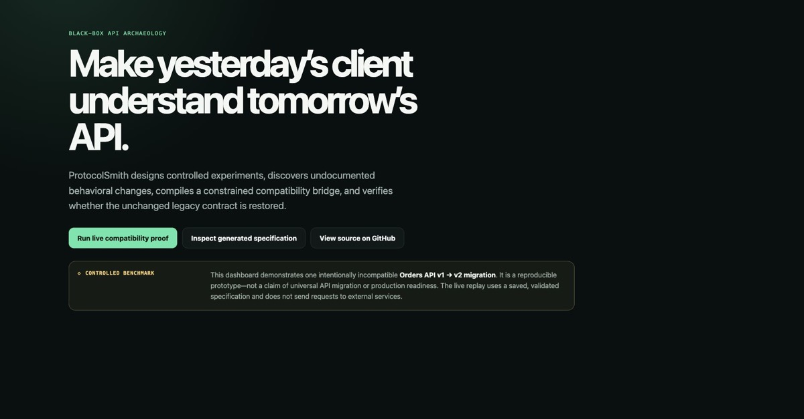
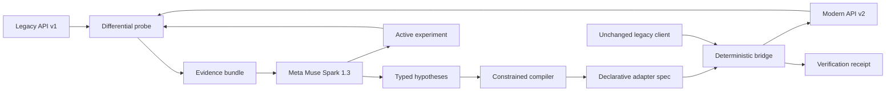

# ProtocolSmith

[](https://github.com/mkhan48-debug/protocolsmith-meta-hackathon/actions/workflows/ci.yml)
[](https://www.python.org/)
[](LICENSE)

**Make yesterday's client understand tomorrow's API.**

ProtocolSmith is an API-archaeology prototype that observes behavioral
differences between API versions, uses Meta Muse Spark to form and test
compatibility hypotheses, compiles supported findings into a constrained
adapter, and deterministically checks whether an unchanged legacy contract
works again.

Built by **Muhammad Rafae Khan** for the **Meta Global AI Developer Hackathon
2026** · Indie Developer track · Push the Frontier theme.

> [!IMPORTANT]
> ProtocolSmith currently demonstrates one synthetic, intentionally
> incompatible Orders API v1 → v2 migration. The recorded 15/15 result applies
> to that controlled benchmark; it is not a claim of universal API migration,
> production readiness, or customer deployment.

[](https://mkhan48-debug.github.io/protocolsmith-meta-hackathon/)

## Start here

- **Browse it:** open the
  [public recorded-evidence showcase](https://mkhan48-debug.github.io/protocolsmith-meta-hackathon/).
  It is a serverless replay of the committed receipt, not a hosted backend.
- **Run it:** follow [Quick start](#quick-start); replaying the committed proof
  requires no Meta API key.
- **Review it:** use the [two-minute demo guide](docs/DEMO.md).
- **Audit it:** read the exact
  [evidence and claim boundary](docs/CONTROLLED_BENCHMARK.md).
- **Release it:** use the [v0.1.0 checklist](docs/RELEASE_CHECKLIST.md) and
  [draft release notes](docs/RELEASE_NOTES_v0.1.0.md).

## The problem

API migrations rarely fail only because a field was renamed. A client can
break when request parameters, nesting, types, pagination, error bodies, HTTP
semantics, or retained information change. Documentation often omits those
behavioral details.

ProtocolSmith treats compatibility as an evidence problem:

1. Observe both versions with controlled requests.
2. Preserve status codes, shapes, values, errors, and pagination behavior.
3. Ask Muse for typed hypotheses and a discriminating follow-up experiment.
4. Compile supported rules into a small declarative operation allowlist.
5. Execute those rules in a deterministic bridge.
6. Replay the legacy contract and disclose unsupported or lossy behavior.

## The decisive proof

The same legacy contract is exercised along three paths:

```text
Unchanged legacy client → API v1
PASS

Unchanged legacy client → API v2 directly
EXPECTED INCOMPATIBILITY: the legacy "orders" field is absent

Unchanged legacy client → ProtocolSmith bridge → API v2
PASS for the controlled contract
```

The committed adapter translates the benchmark's observed differences:

```text
page_size                → limit
customer_id              ← customer.id
orders                   ← data
id                       ← order_id
total_cents              ← amount.value
created_at               ← created
status                   ← state
next_page                ← pagination.next_cursor
HTTP 404 legacy error    ← HTTP 200 modern error object
```

The `created_at` conversion is intentionally not described as exact: v2
discarded time of day, so the bridge reconstructs midnight UTC and emits an
explicit warning.

## Evidence at a glance

| Evidence | Recorded result | What it supports |
| --- | ---: | --- |
| Paired discovery | 3 experiments; 10 reported changes | Candidate mappings for the known synthetic route |
| Active experiment | 6/6 controlled outcomes matched | `page_size` ↔ `limit` for the tested value |
| Adapter artifact | Constrained JSON rules | Reviewable deterministic execution plan |
| Verification receipt | 15/15 contract checks passed | Restoration of the tested synthetic legacy contract |

The active experiment uses a baseline, the other version's parameter name, and
the proposed version-specific name against each API. Both swapped-name negative
controls are required to pass before the mapping is accepted. The other
adapter rules are supported by paired observations and deterministic replay;
they have not each received an independent causal probe.

See [docs/CONTROLLED_BENCHMARK.md](docs/CONTROLLED_BENCHMARK.md) for the full
matrix, receipt contents, and unresolved risks.

## Why Meta Muse Spark is essential

Muse Spark 1.3 is part of the experimental reasoning loop, not a generic chat
surface or a coding-only assistant. It performs three bounded tasks:

1. **Compatibility discovery:** infer typed hypotheses from paired black-box
   observations.
2. **Safe adapter compilation:** produce a declarative specification limited
   to supported operations.
3. **Active experiment design and assessment:** propose a discriminating probe
   and assess the returned evidence.

ProtocolSmith treats model output as untrusted data. Pydantic constrains the
shape; deterministic code validates and executes the allowlisted operations.
ProtocolSmith never executes arbitrary model-generated source code.

The live dashboard button does not call Muse. It replays local requests using
the previously generated, committed specification.

## Architecture



## Safety design

- Model responses must satisfy typed schemas.
- Adapter operations come from a deliberately small allowlist.
- Generated source code is never executed.
- Remote targets are blocked unless explicitly enabled.
- Redirects are disabled, requests use timeouts, and response size is bounded.
- Required response paths and USD currency assumptions are validated.
- Unsupported transformations fail instead of silently guessing.
- Lossy date reconstruction is exposed in a response warning and receipt.
- The local `.env` file is ignored so model credentials are not committed.

These are prototype safeguards, not a production security guarantee. See
[SECURITY.md](SECURITY.md).

## Quick start

### Requirements

- Python 3.12 or newer
- [`uv`](https://docs.astral.sh/uv/getting-started/installation/)

### Clone, install, and run

```bash
git clone https://github.com/mkhan48-debug/protocolsmith-meta-hackathon.git
cd protocolsmith-meta-hackathon
uv sync --locked --all-groups
uv run protocolsmith
```

No API key is required for this replay. The launcher starts the synthetic API
laboratory, bridge, and dashboard, then prints the dashboard URL. It attempts
to open that URL in a browser; if no window appears, copy the printed URL
manually.

Run v0.1.0 from a Git source checkout. The current Python wheel/sdist does not
bundle the root-level dashboard template and evidence artifacts, so it is not
being presented as a standalone PyPI distribution.

If the default ports already host a healthy ProtocolSmith pair, the launcher
reuses it. If another local service occupies a default port, it selects nearby
free ports and prints the selected URL. The printed URL is therefore
authoritative.

To suppress browser auto-opening:

```bash
PROTOCOLSMITH_NO_BROWSER=1 uv run protocolsmith
```

Press `Control+C` once to stop services started by the active launcher.

### What to click

Open the printed dashboard URL and select **Run live compatibility proof**.
The dashboard shows the legacy pass, expected direct-v2 incompatibility, bridge
pass, live contract checks, committed receipt, and known information loss.

## Manual start

Start the controlled API laboratory:

```bash
uv run uvicorn protocolsmith_meta_hackathon.lab_api:app \
  --host 127.0.0.1 \
  --port 8000
```

In another terminal, start the dashboard and bridge:

```bash
uv run uvicorn protocolsmith_meta_hackathon.dashboard_api:app \
  --host 127.0.0.1 \
  --port 8001
```

Open `http://127.0.0.1:8001`. For startup problems and port diagnostics, see
[docs/DEMO.md](docs/DEMO.md#troubleshooting).

## Command-line proof

With the stack running on its default ports:

```bash
# Original contract succeeds
uv run python scripts/legacy_client.py \
  --base-url http://127.0.0.1:8000/v1

# Same client encounters the expected incompatibility
uv run python scripts/legacy_client.py \
  --base-url http://127.0.0.1:8000/v2

# Same client succeeds through the generated bridge
uv run python scripts/legacy_client.py \
  --base-url http://127.0.0.1:8001
```

If the launcher selected alternate ports, use the URLs it printed instead.

## Tests

```bash
uv run python -m compileall -q src scripts tests
uv run pytest -q
```

GitHub Actions runs the test suite, including the real local HTTP-stack proof,
on pushes to `main` and on pull requests.

The public showcase is generated from the same committed evidence and template:

```bash
uv run python scripts/build_static_showcase.py
```

Its replay is deliberately labeled **recorded**. The FastAPI stack remains the
authoritative live demonstration.

## Evidence artifacts

| Artifact | Purpose |
| --- | --- |
| `artifacts/discovery_report.json` | Paired observations, model-assisted compatibility plan, confidence, and unresolved risks |
| `artifacts/active_probe_trace.json` | Muse proposal, six executed controls, assessment, and acceptance verdict |
| `artifacts/adapter_spec.json` | Constrained rules consumed by the deterministic bridge |
| `artifacts/verification_receipt.json` | 15 recorded contract checks, supporting responses, and known loss |

This chain is auditable but not cryptographically signed or independently
replicated. The dashboard's live button performs a compact five-request replay;
the displayed 15/15 total comes from the broader committed receipt.

## Regenerate model-assisted artifacts

The normal demo does not need a model key. Regeneration does:

```bash
cp .env.example .env
# Add MODEL_API_KEY to the local .env file
```

Follow [docs/REGENERATING_ARTIFACTS.md](docs/REGENERATING_ARTIFACTS.md) for the
ordered procedure. Regenerated JSON is a new experimental result and must be
reviewed rather than assumed equivalent to the committed evidence.

## Repository map

```text
src/protocolsmith_meta_hackathon/
  lab_api.py          Synthetic incompatible API versions
  bridge_api.py       Constrained deterministic adapter runtime
  dashboard_api.py    Dashboard and live-proof endpoint
  demo.py             One-command launcher

scripts/
  build_static_showcase.py  Generate the serverless evidence replay
  check_meta_api.py   Meta Model API connection check
  legacy_client.py    Unchanged legacy contract client
  run_discovery.py    Differential evidence and Muse analysis
  compile_adapter.py  Constrained adapter compilation
  run_active_probe.py Model-designed controlled experiment
  verify_bridge.py    Deterministic verification receipt

artifacts/            Committed discovery-to-verification evidence
tests/                Unit, launcher, control-matrix, and HTTP-stack tests
docs/                 Demo, evidence boundary, regeneration, and release guides
assets/screenshots/   Browser-verified reviewer and social assets
```

## Current limitations

- One synthetic Orders domain and one known endpoint family
- Bounded candidate parameter names rather than arbitrary endpoint discovery
- A deliberately small transformation-operation allowlist
- One causally controlled request-parameter mapping; other rules rely on paired
  evidence and replay
- Only `null` pagination values, USD, two statuses, and one error family
  observed
- Irrecoverable time-of-day loss in the modern fixture
- No arbitrary production authentication, secret/PII redaction, tenant
  isolation, rate-limit policy, or scale evaluation
- Remote probing requires explicit opt-in and must only target authorized
  systems

The complete boundary is maintained in
[docs/CONTROLLED_BENCHMARK.md](docs/CONTROLLED_BENCHMARK.md).

## Project and release documents

- [Hackathon work declaration](HACKATHON.md)
- [Submission copy](SUBMISSION.md)
- [Contribution guide](CONTRIBUTING.md)
- [Research and product roadmap](docs/ROADMAP.md)
- [Changelog](CHANGELOG.md)
- [Security policy](SECURITY.md)
- [Draft v0.1.0 release notes](docs/RELEASE_NOTES_v0.1.0.md)
- [Release checklist](docs/RELEASE_CHECKLIST.md)

Until a GitHub release is tagged, the repository should be treated as an
unreleased v0.1.0 development snapshot. The intended first release is a GitHub
source release, not a PyPI package.

## License

ProtocolSmith is available under the [MIT License](LICENSE). Standard
open-source dependencies are identified in the project metadata and are not
claimed as original work.
